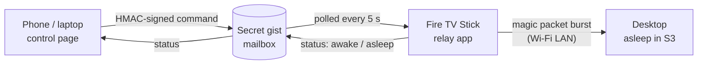

# pc-wake

Wake my desktop from anywhere, over Wi-Fi, with a Fire TV Stick as the always-on relay. The PC sleeps instead of idling 24/7, and one tap on my phone brings it back.



No port forwarding, no VPN, no server. Both ends only make outgoing HTTPS calls to the GitHub API, and the gist is the mailbox between them.

## Pieces

**`core/`:** magic packet, signature checks, and the gist client. The JVM tests live here, so they don't need a device.

**`app/`: Fire TV relay** (Kotlin, no frameworks beyond OkHttp)
- Foreground service that polls the gist every 5 s with ETags, so "nothing changed" replies don't count against the rate limit.
- Verifies each command, fires a Wake-on-LAN burst (ports 9 and 7, to the subnet broadcast, the global broadcast, and the PC itself), and confirms the PC woke by ping or SMB, then writes the result back. A blocked global broadcast does not cancel the other sends.
- Stays alive on Fire OS: wake and Wi-Fi locks, auto-restart on boot and after updates, a 15 min watchdog alarm, Doze-exempt.
- Writes status only when something changes, plus a 15 min keepalive.
- The TV screen shows live status and recent activity. **Test relay** checks every link (config, service, network, mailbox and token, power saving, the phone page) without waking the PC.

**`docs/`: control page** (static, GitHub Pages)
- Signs commands in the browser with WebCrypto and polls for the relay's answer.
- Config lives only in that browser's storage. Phone setup is a one-time QR link: the config rides in the URL fragment, which never reaches a server and is wiped from the address bar on load.
- No third-party scripts at runtime. The QR library is bundled and was checked against its npm integrity hash.

## Security model

- Treat the gist as public. GitHub "secret" gists are unlisted, not private.
- Every command is `HMAC-SHA256(secret, action|timestamp|nonce)`. The relay rejects bad signatures, anything older than 2 min, replayed nonces (it remembers the last 64), and every action except `wake`.
- Worst case if everything leaks: someone wakes my PC. It still sits at a password-protected lock screen.
- Nothing personal is in this repo. The token, signing secret, gist ID, MAC and IP live in `files/config.json` on the Stick (pushed over ADB) and in the phone's browser.

## The hard part: Wake-on-LAN over Wi-Fi

Wired WoL is routine. Wi-Fi WoL (WoWLAN) depends on the card, the driver, the router and the BIOS all cooperating, and most guides say don't bother. Setup here: MSI PRO B660M-A, Intel AX201 (CNVi), Google Nest Wifi.

What it took:
- **The BIOS gate nobody mentions.** Windows was fully configured, every device reported it could wake from S3, and a UDP listener proved the phone's packets were arriving. Still nothing. The AX201 is a CNVi card on the chipset bus, not a PCIe slot, so the switch that matters is *Resume By Intel Onboard LAN*, not the PCIe wake option.
- **Random hardware addresses off.** A sleeping card only answers packets for the MAC it was using, and with randomization on, that isn't the real one.
- **ErP off, S3 sleep only.** Hibernate and shutdown power the radio down.
- **Two timing quirks, handled in code.** The card ignores packets for ~20-30 s after the PC goes to sleep, and single packets get dropped. The relay re-bursts every ~10 s for up to 60 s and stops as soon as the PC answers.

## Set up

About 30-45 minutes. The long version, including the BIOS switches, is [SETUP.md](SETUP.md). Nothing here opens a port on the home network.

1. **Prove the PC wakes over Wi-Fi first.** BIOS wake for the onboard LAN, ErP off, Windows "Wake on Magic Packet" on, random hardware addresses off, S3 sleep only. Write down the MAC, the IP, and the broadcast (`x.x.x.255` on a normal home LAN). Allow ping from the local subnet, then wake it from a phone app after it has been asleep for 30 seconds. If that fails, the access point is often blocking device-to-device traffic. Fix that before continuing; the relay sends the same kind of packet.
2. **Make a secret gist** with `command.json` containing `{"cmd":null}` and `status.json` containing `{}`. The gist id is the last part of the URL.
3. **Make a token** that can read and write gists. Fine-grained: public repositories, account permission Gists read and write, nothing else. If that permission isn't listed, a classic token with only the `gist` scope is the fallback. The token expires. The gist and the signing secret don't.
4. **Make a signing secret** with `openssl rand -base64 32`.
5. **Install the relay** on a Fire TV Stick that is on the same Wi-Fi and plugged into a wall adapter. From this repo, with JDK 17 and the Android SDK: `./gradlew assembleDebug`, then `adb install -r app/build/outputs/apk/debug/app-debug.apk`.
6. **Push the config.** Copy [config.example.json](config.example.json) to `config.json`, fill in real values, and push it with the adb command in SETUP. Delete the local file when you're done. [.env.example](.env.example) is the same list as placeholders for anything that expects env vars. The app does not read `.env`, and real values never go in git.
7. **Keep the Stick awake** with the one-time adb settings in SETUP, then open PC Wake on the TV. **Test relay** checks config, the service, the network, the gist, and power saving. It does not wake the PC.
8. **Turn on GitHub Pages** for this repo, branch `main`, folder `/docs`. Open the HTTPS page, save the token, secret, and gist id, and use **Phone setup QR** for the phone. The QR carries those values in the URL fragment. Don't screenshot it. A page opened from disk can't sign commands.

## Check the code

Unit tests don't need a device or a token:

```
./gradlew test assembleDebug
node docs/protocol.test.js
```

GitHub Actions runs both on every push and pull request.

## Still done by hand

The repo can't create the GitHub gist or token, can't change the BIOS or the router, and can't install the app on the Stick. Those stay with you. Wake-on-LAN over Wi-Fi only works if the PC, the Wi-Fi card, and the access point already cooperate. The phone test in step 1 is the check.
