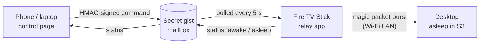

# pc-wake

Wake my desktop from anywhere, over Wi-Fi, with a Fire TV Stick as the always-on relay. The PC sleeps instead of idling 24/7, and one tap on my phone brings it back.

No port forwarding, no VPN, no server. Both ends only make outgoing HTTPS calls to the GitHub API, and the gist is the mailbox between them.

## Pieces

**`app/`: Fire TV relay** (Kotlin, no frameworks beyond OkHttp)
- Foreground service that polls the gist every 5 s with ETags, so "nothing changed" replies don't count against the rate limit.
- Verifies each command, fires a Wake-on-LAN burst, and confirms the PC woke by ping or SMB, then writes the result back.
- Stays alive on Fire OS: wake and Wi-Fi locks, auto-restart on boot and after updates, a 15 min watchdog alarm, Doze-exempt.
- Writes status only when something changes, plus a 15 min keepalive.
- The TV screen shows live status and recent activity. **Test relay** checks every link (config, service, network, mailbox and token, power saving, the phone page) without waking the PC.

**`docs/`: control page** (static, GitHub Pages)
- Signs commands in the browser with WebCrypto and polls for the relay's answer.
- Config lives only in that browser's storage. Phone setup is a one-time QR link: the config rides in the URL fragment, which never reaches a server and is wiped from the address bar on load.
- No third-party scripts at runtime. The QR library is bundled and was checked against its npm integrity hash.

## Security model

- Treat the gist as public. GitHub "secret" gists are unlisted, not private.
- Every command is `HMAC-SHA256(secret, action|timestamp|nonce)`. The relay rejects bad signatures, anything older than 2 min, replayed nonces, and every action except `wake`.
- Worst case if everything leaks: someone wakes my PC. It still sits at a password-protected lock screen.
- Nothing personal is in this repo. The token, signing secret, gist ID, MAC and IP live in `files/config.json` on the Stick (pushed over ADB) and in the phone's browser.

## The hard part: Wake-on-LAN over Wi-Fi

Wired WoL is routine. Wi-Fi WoL (WoWLAN) depends on the card, the driver, the router and the BIOS all cooperating, and most guides say don't bother. Setup here: MSI PRO B660M-A, Intel AX201 (CNVi), Google Nest Wifi.

What it took:
- **The BIOS gate nobody mentions.** Windows was fully configured, every device reported it could wake from S3, and a UDP listener proved the phone's packets were arriving. Still nothing. The AX201 is a CNVi card on the chipset bus, not a PCIe slot, so the switch that matters is *Resume By Intel Onboard LAN*, not the PCIe wake option.
- **Random hardware addresses off.** A sleeping card only answers packets for the MAC it was using, and with randomization on, that isn't the real one.
- **ErP off, S3 sleep only.** Hibernate and shutdown power the radio down.
- **Two timing quirks, handled in code.** The card ignores packets for ~20-30 s after the PC goes to sleep, and single packets get dropped. The relay re-bursts every ~10 s for up to 60 s and stops as soon as the PC answers.

## Run your own

Everything you need is in [SETUP.md](SETUP.md): about 30-45 minutes. The only step that can truly fail is the first one, checking your PC wakes over Wi-Fi. The rest is copy and paste.
