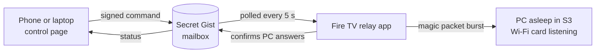

# pc-wake

Wake a sleeping desktop from anywhere, over Wi-Fi, using a Fire TV Stick as the always-on relay.

No port forwarding, no VPN, no always-on PC, no Ethernet. A phone sends a signed command through a GitHub Gist, a small Android TV app on the Fire Stick picks it up and fires a Wake-on-LAN magic packet on the home network, and the PC wakes in a few seconds. From there, connect with whatever remote desktop client you use.

## How it works



1. **Control page** (`docs/`, GitHub Pages): one Wake button. It signs a command and writes it to `command.json` in a secret gist.
2. **Relay** (`app/`, Kotlin, Fire OS 8 / Android 11): a foreground service on the Fire TV Stick checks the gist every 5 seconds using ETags, so idle polling does not count against the GitHub rate limit.
3. **Wake**: on a valid command the relay sends a burst of magic packets (subnet broadcast, global broadcast and direct to the PC), then pings until the PC answers.
4. **Report**: the relay writes the result to `status.json`; the page shows it, along with when the relay was last seen and whether the PC is awake.

Round trip from button press to "awake" is a few seconds plus the PC's own resume time.

## Security model

The repo and the page are public. Nothing in them is secret.

- **Signed commands.** Every command is HMAC-SHA256 signed over `action|timestamp|nonce` with a passphrase only the relay and your devices know.
- **No replays.** The relay rejects bad signatures, commands older than 2 minutes, and any nonce it has already seen.
- **Wake only.** The only action is waking the PC. Nothing here can unlock, control or shut it down; the OS login stays in place.
- **Least privilege.** The GitHub token is fine-grained with Gists read/write only.
- **Secrets stay on devices.** Token, passphrase, gist id and the PC's MAC/IP live in `files/config.json` on the Stick (pushed over ADB) and in the browser's local storage on your phone. A one-time setup link (QR code) moves them to a phone without typing; the secrets ride in the URL fragment, which is never sent to a server and is wiped from the address bar on load.

## Hardware notes

Tested on an MSI PRO B660M-A WIFI (Intel AX201 Wi-Fi) and a Fire TV Stick 4K (2nd gen, Fire OS 8.1).

Wake-on-Wireless-LAN only works from **sleep (S3)**. In hibernate or shutdown the Wi-Fi card is fully off.

The finding that cost the most time: on this board the built-in Intel Wi-Fi is part of the chipset (CNVi), not a PCIe card. So the BIOS option that gates its wake signal is **Resume By Intel Onboard LAN**, not *Resume By PCI-E Device*. Windows reported every device as able to wake from S3 and every setting was correct; the BIOS was silently blocking the signal.

Checklist that made it work:

| Layer | Setting |
| --- | --- |
| BIOS | Resume By Intel Onboard LAN: Enabled; Resume By PCI-E/Networking Device: Enabled; ErP Ready: Disabled |
| Windows, Device Manager | Wi-Fi adapter: Allow this device to wake the computer + Only allow a magic packet |
| Windows, adapter Advanced | Wake on Magic Packet: Enabled; ARP / NS / GTK rekey offload for WoWLAN: Enabled |
| Windows, Wi-Fi network | Random hardware addresses: Off (the magic packet targets the real MAC) |
| Windows Firewall | Allow inbound ICMPv4 echo from the local subnet, so the relay can confirm the PC is up |

Known quirks: packets sent in the first 20 to 30 seconds after the PC goes to sleep do nothing (the card is still switching modes), and single packets sometimes get dropped on Wi-Fi. The relay handles both with a burst and a confirm-and-retry loop.

## Setup

Requirements: JDK 17, Android SDK (platform 34, build-tools 34), ADB debugging enabled on the Fire TV.

```
adb connect <fire-tv-ip>:5555
gradlew assembleDebug
adb install -r app/build/outputs/apk/debug/app-debug.apk
```

Create a secret gist with two files, `command.json` (`{"cmd":null}`) and `status.json` (`{}`), then push the relay config:

```
adb shell "run-as com.marcosvec.pcwake sh -c 'cat > files/config.json'" < config.json
```

`config.json` keys: `token`, `secret`, `gist_id`, `pc_mac`, `pc_ip`, `broadcast`. Open the app once on the TV; the relay service starts and restarts itself on boot.

On the control page, open **Setup on this device**, enter the token, passphrase and gist id, then use **Phone setup QR** to move them to your phone.

## Status

- Working: wake from the phone on any network, signed commands, status reporting, start on boot.
- In progress: multi-day survival test of the relay on Fire OS (which is aggressive about killing background apps).